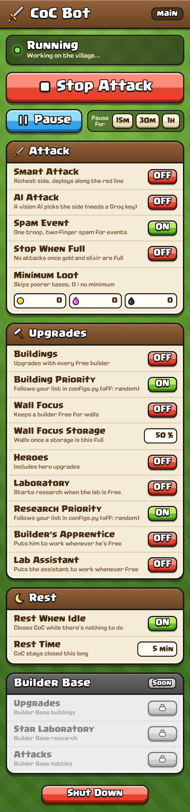

<h1 align="center">Clash of Clans Bot</h1>
<p align="center">
    A farming bot for Clash of Clans on BlueStacks, adapted to the November 2026 game update (CoC 18.647), with a desktop app styled like the game and a rest mode that keeps a fanless Mac cool.
</p>
<p align="center">
    
    <br>
    <sub>A Spam Event attack: one troop type swept in with two fingers along both sides, then the spells spread over the base</sub>
</p>

This is a fork of [CoC_Bot by m24842](https://github.com/m24842/CoC_Bot). Tested on a MacBook Air M1 with BlueStacks Air.

## What's New in This Fork
* **Works with the new CoC UI**: upgrades through the new Build panel, the builder and lab counters in their new spot, the new battle result screen, and the new Builder's Apprentice and Lab Assistant panel
* **Spam Event attack**, on by default: one troop type spammed with two held fingers along the side lines, heroes with their abilities, spells spread out
* **Smart Attack** along the red line, an optional **AI Attack** (a vision model picks the side), **Minimum Loot** and **Stop When Full**
* **Exact storage reading**: gold, elixir and dark elixir read digit by digit, and how full each storage is
* **Desktop app styled like Clash of Clans**, with a Start Attack button and a Pause that stops every touch at once
* **Rest When Idle**: CoC closes while there's nothing to do, so the computer stays cool
* **Double-click CoC Bot.app** to open the bot. It asks for no password and keeps the Mac awake while it runs
* **Automatic CoC updates** work again
* **Reference screenshots and offline checks** for adapting the bot to the next CoC update

## Features
### Home Village
* Building, wall and hero upgrades with every free builder, in random order or following your priority list 🧱👑
* Wall Focus: keeps a builder free for walls and spends spare loot on them once a storage is full enough 🧱
* Laboratory research whenever the lab is free 🔬
* Puts the Builder's Apprentice and Lab Assistant to work whenever they're free ⏩️
* Attacks ⚔️
    * Spam Event (default): built for event armies. It brings one troop type and spams it with two fingers held at once, one per side, then deploys heroes, fires their abilities and spreads the spells
    * Smart Attack: attacks the richest side(s) and deploys along the red line
    * AI Attack: a vision model picks the side by loot and weakest defenses (needs a [Groq](https://console.groq.com) key)
    * Minimum Loot: presses Next (up to 10 times) until a base's gold, elixir and dark elixir all meet your minimums
    * Stop When Full: no attacks once gold and elixir are both at least 90% full
    * Returns home after every battle, waits out a battle still running when the bot starts, closes the "Rate Clash of Clans" dialog and leaves a watched defense
* Automatic CoC updates through Google Play 🔼

### Builder Base
* Not adapted to the new CoC UI yet. Its switches are locked in the app

## Desktop App


* Double-click **CoC Bot.app**. Keep it in the bot folder and put an alias on your Desktop. No Terminal window and no password
* Opening it again while the bot runs brings its window to the front instead of starting a second bot
* **Status**: Running, Resting until the next check, Paused, or Standby when everything is off
* **Start Attack / Stop Attack**: Stop Attack takes effect after the current battle
* **Pause** for 15 minutes, 30 minutes, 1 hour, or until **Resume**. Every touch stops at once and held fingers are lifted, so you can play yourself. Resume starts the round over
* Switches for every attack, upgrade and rest option, plus the Minimum Loot and Rest Time fields
* **Shut Down** stops the bot and closes BlueStacks, and so does closing the window
* The computer stays awake while the window is open (`DISABLE_DEVICE_SLEEP`). On a Mac this uses `caffeinate`, so closing a laptop's lid still puts it to sleep
* Startup output goes to `debug/launcher.log` and the bot's own log to `debug/main.log`

<br clear="right">

## Keeping the Computer Cool
* **Rest When Idle**: a round that fought no battle and started no upgrade (storages full, builders and lab busy) closes CoC for the Rest Time, 5 minutes by default. Flipping a switch in the app ends the rest at once. Your village can be attacked while CoC is closed
* BlueStacks drawing the open game is what heats the computer, not the bot itself. On a MacBook Air M1 with the settings below, BlueStacks used about 75% CPU with CoC open and idle, and about 2% with CoC closed
* Recommended BlueStacks settings: 2 CPU cores, 3 GB memory, 30 FPS

## From the Original Project
These are still in the code, but haven't been re-tested since the adaptation to CoC 18.647:
* Web app with status, switches and notifications, and an iPhone shortcut that pauses the bot while you play on your phone ⏯️
* Telegram notifications 🔔
* Multiple accounts, one BlueStacks instance each 👥

## Requirements
1. Python 3.11. `python3.11 setup.py` creates `.venv`, installs the packages and creates `src/configs.py` from [configs.template.py](src/configs.template.py)
2. [Android Debug Bridge](https://developer.android.com/tools/releases/platform-tools) on your PATH. On a Mac: `brew install android-platform-tools`. Check it with `adb --version`
3. [BlueStacks](https://www.bluestacks.com/). Tested with BlueStacks Air 5.21 on Apple Silicon
    * Display resolution: 1920 x 1080 (landscape)
    * Performance: 2 CPU cores and 3 GB memory are enough for CoC and keep the computer cooler
    * Frame rate: 30. 60 also works but keeps the computer hotter. After changing it, `python scripts/touch_check.py` checks on the live game that every tap, swipe and pinch still lands
    * Device profile: a Samsung Galaxy profile (tested with SM-G998B)
    * Enable Android Debug Bridge (Settings > Advanced). The bot expects it at `127.0.0.1:5555`
    * Install Clash of Clans from Google Play. Use the default troop deployment size and the Standard or XL scenery
4. [minitouch](https://app.unpkg.com/minitouch-prebuilt-support10@1.2.0/files/prebuilt) is set up by pyminitouch automatically. To install it by hand: run `adb shell getprop ro.product.cpu.abi` to pick the right prebuilt binary, then:
    ```bash
    adb connect 127.0.0.1:5555
    adb push <path-to-minitouch> /data/local/tmp/
    adb shell chmod 755 /data/local/tmp/minitouch
    ```

## Setup
1. Install the requirements above
2. Edit `src/configs.py`
    > __Note__: Most options can be changed while the bot runs from the desktop app (or the web app). Spam Event, Smart Attack, Stop When Full and Rest When Idle start on.

    > __Note__: Upgrade priorities are explained in `configs.py`.

    > __Note__: `GROQ_API_KEY` is only needed for AI Attack. Keep `configs.py` private: it is ignored by git.
3. Open BlueStacks and wait for the Android home screen
4. Start the bot: double-click **CoC Bot.app**, or run `python src/main.py`
    > 💡 __Tip__: The BlueStacks window can be minimized: the bot works through Android Debug Bridge.

    > 💡 __Tip__: `scripts/build.sh` can also build a standalone app with PyInstaller.
5. Optional, from the original project:
    * Web app: `python app/app.py`, then each bot instance is at `WEB_APP_URL/<instance_id>`. The default instance ID is `main`. It can be hosted on [pythonanywhere](https://www.pythonanywhere.com) with [wsgi.py](app/wsgi.py). Set `PA_USERNAME` and `PA_PASSWORD` to let the bot extend the free hosting automatically
    * iPhone shortcut: create a [Scriptable](https://apps.apple.com/us/app/scriptable/id1405459188) script named "CoC Bot Script" from [Scriptable.js](<shortcut/Scriptable.js>), open the [shortcut](<shortcut/CoC Bot Auto Pause.shortcut>), enter your `WEB_APP_URL` and instance IDs, and make an Automation that runs it when CoC opens. iOS ends long-running shortcuts after 30–60 minutes, so set it to run after confirmation if you want longer pauses
    * Telegram: create a [Telegram bot](https://core.telegram.org/bots#how-do-i-create-a-bot), send it `/start`, and put its token in `TELEGRAM_BOT_TOKEN`
    * More accounts: make one BlueStacks instance per account in the Multi-Instance Manager, named like the bot's instance IDs. Add each name and ADB address to `INSTANCE_IDS` and `ADB_ADDRESSES`, then start one with `python src/main.py --id <name>`

## After a Clash of Clans Update
Game updates move buttons and restyle screens. [tests/ui_frames](tests/ui_frames) keeps pixel-exact screenshots of each UI the bot was adapted to, and [manifest.json](tests/ui_frames/manifest.json) records what each one shows and what the bot must read from it.
* `python scripts/panel_eval.py` and `python scripts/loot_eval.py` check the bot's screen readers (upgrade panel, battle result, dialogs, loot) against those frames; exit code 0 means all agree
* `python scripts/storage_eval.py` checks that the gold, elixir and dark elixir counters are read digit for digit and each storage's fill within 1%, that a covered or dimmed counter reads as nothing, and that attacks stop only once gold and elixir are both 90% full
* `python scripts/ui_probe.py <screenshot> scan` scores every template on a screenshot, and `eval "<expression>"` runs any bot function on it
* `python scripts/capture_frame.py <folder/name>` saves the live BlueStacks screen as a new reference frame
* `python scripts/pause_eval.py` checks with a fake device that a Pause lets no tap, swipe, screenshot or app command through and that the bot then starts over
* `python scripts/rest_eval.py` checks offline that only a round with nothing to do closes CoC and rests, and that a switch flipped in the app or a Pause ends the rest
* `python scripts/update_eval.py` checks with a fake device that the automatic CoC update presses only CoC's and Google Play's Update button, stays quiet when there's no update, and lets a Pause stop it before any click
* `python scripts/touch_check.py` opens and closes the Build panel, switches its tabs, swipes its list and pinches the village on the live game (nothing bought), reporting every gesture the game missed: run it after changing BlueStacks' frame rate, cores or memory
* `python scripts/upgrade_dryrun.py` drives the real upgrade flows on the live game while blocking every tap that would spend resources (`upgrade_dryrun.py helpers` walks the Builder's Apprentice and Lab Assistant flows up to their blocked Confirm while both are idle)

## Troubleshooting
* **Supercell ID screens (switch account, Open) are black** while the game itself shows fine. On BlueStacks Air, every CoC session that starts on the cache an earlier session left behind draws them black. To switch accounts:
    1. Pause the bot and close CoC
    2. In BlueStacks open Android Settings > Apps > Clash of Clans > Storage & cache
    3. Press __Clear cache__ and start CoC again. That session can switch

    Your account stays logged in. Never press Clear storage: it logs you out, and logging back in goes through those same screens
* **The CoC Bot window doesn't appear**: the reason is in `debug/launcher.log`
* **"Can't reach BlueStacks over ADB"**: open BlueStacks, wait for the Android home screen, check that Android Debug Bridge is on, then start CoC Bot again

## Credits
Based on [CoC_Bot by m24842](https://github.com/m24842/CoC_Bot). Demo videos of the original project: [bot](https://youtu.be/RTaFCiD5v3o), [web app](https://youtu.be/6w2SRJFtSnM), [desktop app](https://youtube.com/shorts/zVZwBW8QIeY?feature=share).
